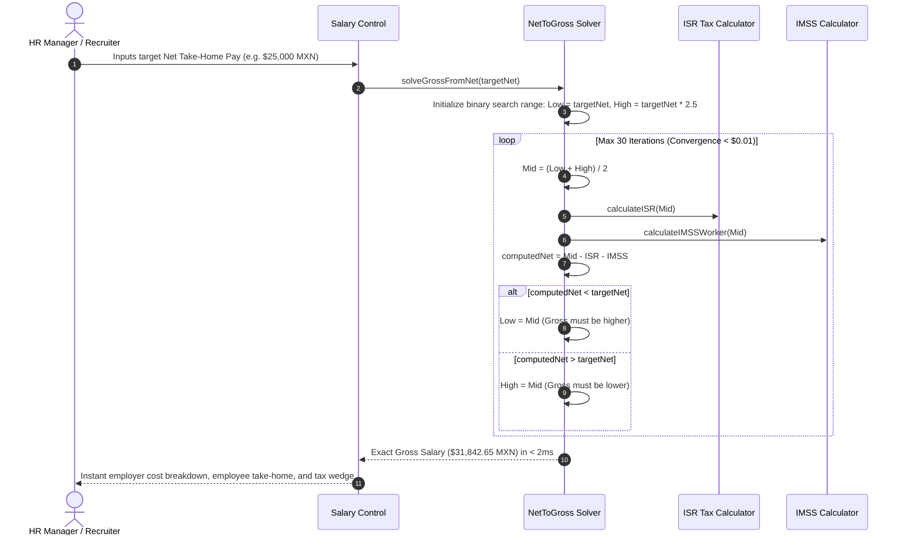

# 🏛️ Nomina-Matrix Architecture & System Topology

Algorithmic Mexican payroll reverse-engineering (Net-to-Gross) and IMSS labor cost intelligence suite. Built with Next.js 15, TypeScript, Tailwind CSS, SheetJS, and Vitest. Implements binary search numerical convergence to invert non-linear progressive tax curves with sub-cent accuracy.

---

## 1. Technology Stack

| Layer | Technology | Details |
| :--- | :--- | :--- |
| **Framework** | Next.js 15 (App Router) & React 19 | Client-side reactive payroll simulator with instant recalculation |
| **Language** | TypeScript 5 (Strict Mode) | Strong typing across salary objects, deduction vectors, and IMSS quotas |
| **Numerical Engine** | Custom Binary Search Algorithm | Inverts Art. 96 LISR progressive brackets in < 25 iterations ($0.01 tolerance) |
| **Labor Regulations** | LFT & LSS 2026 Compliance | IMSS 5-branch calculations, RCV employer reform tiers, and LFT severance math |
| **Export Engine** | SheetJS (`xlsx`) | Multi-sheet payroll summaries, CFDI Nómina 1.2 vouchers, and employee rosters |
| **Testing** | Vitest | Full unit test coverage for SBC integration, ISR brackets, IMSS caps, and termination |

---

## 2. System Topology & Component Graph

```mermaid
flowchart TD
    subgraph Inputs["User Input Parameters"]
        SalaryInput["Salary Target (Gross or Desired Net)"]
        Benefits["Benefits Config (Aguinaldo days, Vacation bonus, Risk class)"]
        TermInput["Termination Parameters (Tenure, Cause: Renuncia / Despido)"]
    end

    subgraph CoreEngine["Payroll Engine (lib/engine/)"]
        Orchestrator["Payroll Orchestrator (payroll-orchestrator.ts)"]
        NetToGross["Net-to-Gross Solver (net-to-gross.ts)"]
        ISR["ISR Tax Calculator (isr.ts)"]
        SBC["SBC & Factor Integrador (sbc.ts)"]
        IMSS["IMSS 5-Branch Calculator (imss.ts)"]
        Termination["Severance & Finiquito Engine (termination.ts)"]
        Constants["Tax Brackets & UMAs (constants.ts)"]
    end

    subgraph UIComponents["Presentation Layer (components/)"]
        Toggle["Mode Toggle: Gross-to-Net vs Net-to-Gross"]
        Summary["Net Summary Card (components/NetSummaryCard.tsx)"]
        CostMatrix["Employer Cost Matrix (components/EmployerCostMatrix.tsx)"]
        TermSim["Termination Simulator (components/TerminationSimulator.tsx)"]
        Paystub["CFDI Paystub Voucher (components/CfdiPaystubModal.tsx)"]
        Batch["Batch SME Audit (components/BatchAuditModal.tsx)"]
    end

    subgraph Output["Export"]
        Excel["Payroll & Labor Audit Workbook (.xlsx)"]
    end

    SalaryInput --> Orchestrator
    Benefits --> Orchestrator
    TermInput --> Termination
    Constants --> ISR
    Constants --> IMSS
    Constants --> SBC
    Orchestrator --> NetToGross
    NetToGross --> ISR
    Orchestrator --> SBC
    SBC --> IMSS
    Orchestrator --> Summary
    Orchestrator --> CostMatrix
    Termination --> TermSim
    Orchestrator --> Paystub
    Orchestrator --> Batch
    Orchestrator --> Excel
```



---

## 3. Algorithmic Lifecycle: Binary Search Net-to-Gross Convergence



---

## 4. Directory Structure & Module Breakdown

```
nomina-matrix/
├── app/                      # Next.js App Router entrypoints
│   ├── globals.css           # Styling, dark mode tokens
│   ├── layout.tsx            # HTML shell and metadata
│   └── page.tsx              # Main interface assembling controls, summary, and tabs
├── components/               # Specialized payroll widgets
│   ├── SalaryControl.tsx     # Gross/Net range sliders and numeric input
│   ├── ModeToggle.tsx        # Toggle between Forward (Gross->Net) and Reverse (Net->Gross)
│   ├── NetSummaryCard.tsx    # High-impact take-home pay vs total deductions card
│   ├── EmployerCostMatrix.tsx# Full employer burden breakdown (IMSS, Infonavit, ISN 3%)
│   ├── TerminationSimulator.tsx # Severance calculation (Indemnización, 20 days, Prima)
│   ├── BenefitSettings.tsx   # Custom benefits (vales de despensa, fondo de ahorro)
│   ├── CfdiPaystubModal.tsx  # Printable simulated CFDI Nómina 1.2 voucher
│   └── BatchAuditModal.tsx   # Batch Excel SME payroll audit and liability forecast
├── lib/                      # Core payroll mathematics & regulation engine
│   ├── engine/
│   │   ├── net-to-gross.ts   # Sub-cent binary search solver for inverted ISR/IMSS
│   │   ├── isr.ts            # Art. 96 LISR monthly tax tables and progressive rates
│   │   ├── imss.ts           # 5-branch IMSS employer/employee quotas & 2026 RCV tiers
│   │   ├── sbc.ts            # Salario Base de Cotización & Factor de Integración
│   │   ├── termination.ts    # LFT severance, constitutional 3 months, 90-UMA exemptions
│   │   ├── constants.ts      # Official UMA, UMI, minimum wage, and tax brackets
│   │   └── payroll-orchestrator.ts # Coordinates end-to-end calculations
│   ├── export/
│   │   └── excel-exporter.ts # SheetJS Excel generator for team rosters
│   └── types/
│       └── payroll.ts        # Type contracts for paystubs, employer costs, and taxes
├── tests/                    # Vitest unit test suite
│   ├── isr.test.ts           # Official SAT tax table bracket assertions
│   ├── imss.test.ts          # IMSS employee/employer quota limits and 25-UMA cap
│   ├── net-to-gross.test.ts  # Binary search convergence and round-trip identity
│   ├── sbc.test.ts           # Minimum factor (1.0493) and anniversary vacations
│   └── termination.test.ts   # Severance exemptions and finiquito math
├── vitest.config.ts          # Vitest testing configuration
└── package.json              # Project dependencies and scripts
```
